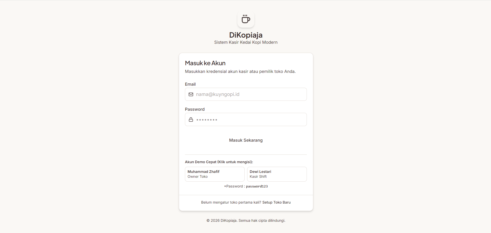
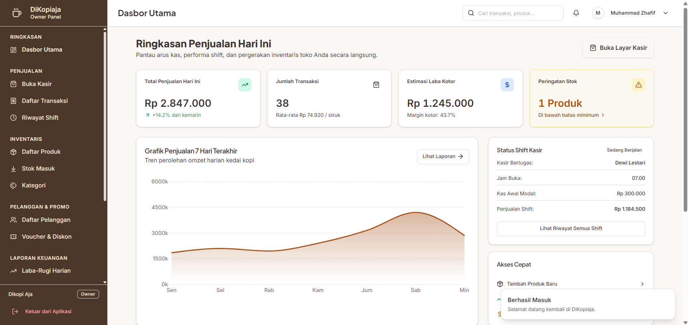
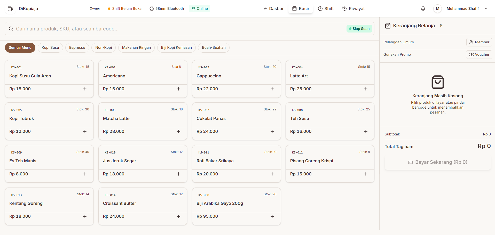

# DiKopiaja

**Sistem Kasir (Point of Sale).**

<div data-importer="techs" align="left">
  
  
  
  
  
  
  
  
  
  
  
</div>

---
## 🚀 Main Technologies

| Kategori | Teknologi |
| --- | --- |
| **Bahasa** | TypeScript (JavaScript), HTML, CSS |
| **Framework / Library** | React 18, React Router 7 |
| **Build Tool** | Vite |
| **Styling** | Tailwind CSS 4, shadcn/ui (Radix UI), class-variance-authority |
| **State & Data** | Zustand, TanStack Query |
| **Form & Validasi** | React Hook Form, Zod |
| **Visualisasi** | Recharts, Lucide React |
| **Lainnya** | date-fns, qrcode, React Helmet Async |
| **Linter** | Oxlint |

---

## ✨ Fitur Utama

- **Kasir**: transaksi cepat dengan keranjang, voucher, dan pratinjau struk
- **Manajemen Shift**: buka/tutup shift beserta riwayatnya
- **Inventaris**: produk, kategori, dan stok masuk
- **Pelanggan & Poin**: program loyalitas dan riwayat pelanggan
- **Voucher**: kelola promo dan diskon
- **Laporan**: dashboard penjualan, laba rugi, dan pencatatan biaya
- **Pembayaran Digital**: GoPay, DANA, ShopeePay, Visa, Mastercard, dan JCB
- **Role-based Access**: hak akses berbeda untuk *Owner* dan *Kasir*
- **Pengaturan**: toko, pengguna, poin, dan printer

---

## 📸 Dokumentasi

### Menu Login

 
### Dashboard Owner

 
### Halaman Kasir


---

## 📁 Struktur Folder

```
src/
├── components/   # Komponen UI & layout
├── pages/        # Halaman (kasir, dashboard, inventaris, dll.)
├── router/       # Routing & proteksi akses
├── store/        # Global state (Zustand)
├── mocks/        # Data dummy
└── lib/          # Utilitas
```

---

Created by **Muhammad Zhafif**
